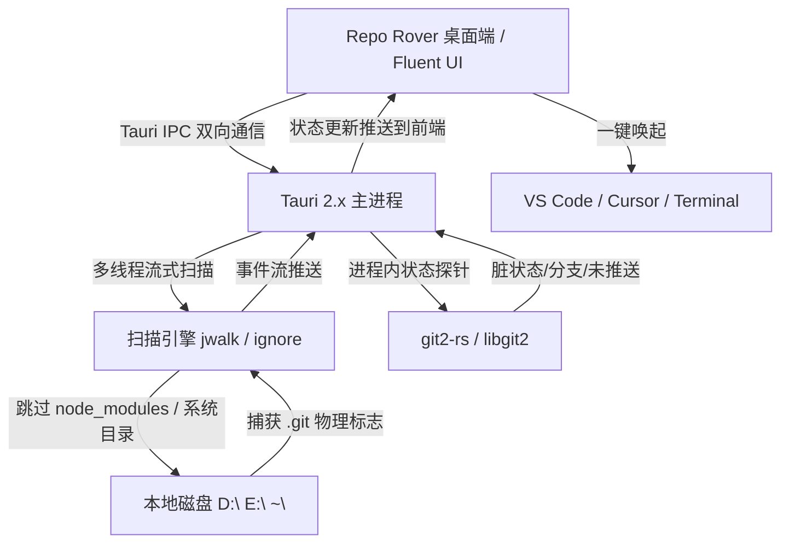

# Repo Rover

<div align="center">


### 🧭 Repo Rover - Git 仓库全盘探针与资产管理中心

一款专为 Windows 平台打造的高性能 Git 仓库全景探针与开发环境治理桌面应用，深度契合 Windows 11 Fluent Design 设计语言，基于 Tauri 2.x 与 Rust 高性能系统内核驱动。

[](https://git-scm.com/)
[](https://tauri.app/)
[](https://www.rust-lang.org/)
[](https://developer.microsoft.com/fluentui)
[](LICENSE)

[核心特性](#-核心特性) • [功能板块](#-三大核心功能板块) • [架构图解](#-工作原理与系统架构) • [快速开始](#-快速开始) • [常见问题](#-常见问题--faq) • [开源协议](#-开源协议)

</div>

---

## 📖 项目简介

在长期的全栈与多项目开发过程中，开发者的本地硬盘中往往散落着数十甚至数百个 Git 仓库。
然而，开发者常常面临以下痛点：
- **仓库失联与遗忘**：分散在不同的磁盘、文件夹深处，时间一长便遗忘了具体路径与项目状态；
- **代码遗失隐患**：许多仓库修改了代码却忘记提交（Dirty），或者提交了却忘记推送到远程源（Unpushed）；
- **环境配置繁琐**：多台设备之间配置 `user.name`、`user.email`、换行符策略或 SSH 密钥排查耗时耗力。

**Repo Rover** 致力于成为开发者的“全盘代码资产管家”。依托 Rust 的并发剪枝遍历能力与进程内 Git 探针，以不到 15MB 的轻巧身姿与极致的毫秒级扫描速度，为 Windows 开发者提供现代化、沉浸式的代码资产治理体验。

---

## ✨ 核心特性

- ⚡ **原生 Rust 极速并发剪枝**：基于多线程工作窃取模型，深度剪枝自动绕过 `node_modules`、`.next`、`dist`、`target`、`AppData` 等无用深层目录，千个项目秒级索引。
- 🩺 **仓库健康度实时探针**：
  - 🔴 **Dirty 脏工作区预警**：精准标出未暂存或未提交代码的仓库；
  - 🟡 **Unpushed 未推送预警**：排查已提交但尚未 Push 到 GitHub/GitLab 的孤立分支；
  - 🟢 **Clean 同步就绪**：一目了然确认工作区安全。
- ⚙️ **Git 运行环境一体化治理**：内置 Git 运行时就绪感知、全局配置 (`user.name`/`user.email`) 可视化修改与 SSH 密钥检测。
- 🚀 **开发工具链无缝联动**：一键在 VS Code、Cursor、Windsurf、Windows Terminal 或文件资源管理器中快速唤起。
- 🎨 **原生 Windows 11 Fluent 视觉**：支持亚克力磨砂、云母半透明质感，完美自适应系统浅色/深色主题。

---

## 🧩 三大核心功能板块

### 1. Git 安装与环境配置相关 (Git Environment)
- **运行时就绪检测**：探测系统 PATH 与注册表中的 `git.exe` 路径与版本；
- **全局配置管理**：支持一键读取与修改 `user.name`、`user.email`、`core.autocrlf` 以及 `init.defaultBranch`；
- **SSH 密钥状态检测**：查看 `~/.ssh/` 密钥对，并支持一键将公钥复制到剪贴板。

### 2. 本地 Git 仓库资产管理 (Repository Assets)
- **双模扫描引擎**：支持“常用开发目录极速侦测”与“全盘并发穿透扫描”；
- **流式响应展示**：扫描期间边找边推送到界面，无卡顿、无假死；
- **多维筛选与搜索**：支持按项目名模糊检索、按健康状态（Dirty/Unpushed）筛选、按远程源平台分组。

### 3. 仓库资产操作与外部协同 (Action Center)
- **快捷启动器**：一键在 VS Code / Cursor / Windsurf / Windows Terminal 中打开；
- **轻量运维**：支持一键批量 `git fetch` 同步远程分支状态与工作区一键 Stash；
- **资产清单导出**：支持导出全盘仓库清单为 Markdown、CSV 或 JSON 报告。

---

## 🛠️ 工作原理与系统架构



---

## 🚀 快速开始

### 环境依赖

- **操作系统**：Windows 10 / Windows 11（推荐 64 位）
- **Node.js**：`>= 18.0.0`（系统已就绪 Node.js 22）
- **Rust 工具链**：`rustc >= 1.75.0`，`cargo`（可通过 `rustup` 或 `mise use -g rust` 就绪）

### 安装与运行

1. **直接秒开已编译的桌面程序 (推荐)**：
   - 双击根目录下的 **`启动桌面客户端.bat`**，或直接打开 `src-tauri\target\debug\repo-rover.exe`。

2. **以热更新开发模式启动**：
   - 双击 **`启动热更新开发环境.bat`**，或执行命令：
     ```powershell
     cd d:\code\10_repo-rover
     npm run start
     ```

3. **纯浏览器 Web 调试模式**：
   - 双击 **`run-web.bat`**，浏览器访问 `http://localhost:1420`。

---

## ❓ 常见问题 (FAQ)

### Q1: 扫描整盘会不会导致电脑卡顿？
**答：不会。** 扫描内核使用 Rust 编写，严格受控于工作窃取线程池（Worker Pool），且内置了完备的剪枝黑名单，遇到 `.git`、`node_modules`、`AppData` 等目录会自动阻断深入递归，极低占用系统资源。

### Q2: 软件是如何判断仓库是“Dirty”或“Unpushed”的？
**答：** 软件通过高效的底层 Git 索引探测机制直接比对工作区索引树与 HEAD Commit，并比对本地分支与其追踪的 upstream 远程分支提交差异（Ahead / Behind），无需任何网络请求即可在毫秒内完成判断。

---

## 📄 开源协议

本项目基于 [MIT 协议](LICENSE) 开源。
